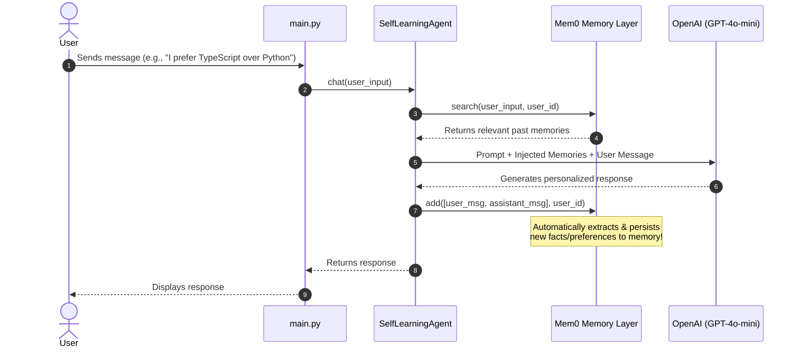

# Self-Learning AI Agent 🧠

A Python framework for building **Self-Learning AI Agents with Long-Term Persistent Memory**, based on the tutorial by **Dave Ebbelaar** ([YouTube Reference](https://www.youtube.com/watch?v=ynhl8KjjS3Y)).

---

## 💡 The Core Idea

Standard LLM chat applications are **stateless** — each conversation begins from scratch, and older context is lost as it falls out of the token window.

This project implements a **self-learning architecture** using **[Mem0](https://github.com/mem0ai/mem0)** and **OpenAI**:
1. **Dynamic Memory Extraction:** The agent automatically extracts personal details, preferences, technical choices, and instructions from user interactions.
2. **Contextual Memory Retrieval:** When a query is asked, the agent semantically searches stored memories and enriches the system prompt with relevant facts.
3. **Continuous Adaptation:** Over time, the agent avoids repeated questions, recalls preferences, adapts to past feedback, and becomes truly personalized across sessions.

---

## 🏗️ Architecture

```
self-learning-ai-agent/
├── src/
│   ├── __init__.py
│   ├── config.py         # Configuration & environment variable loader
│   ├── memory.py         # Mem0 interface (add, search, get_all, reset)
│   └── agent.py          # Self-Learning Agent with memory-augmented prompt
├── .env.example          # Environment variable template
├── .gitignore            # Git ignore rules
├── requirements.txt      # Python dependencies
├── main.py               # Interactive CLI chat with memory inspection
└── README.md
```

### Flow Diagram



---

## 🚀 Setup & Installation

### 1. Prerequisites
- Python 3.10+
- OpenAI API Key

### 2. Install Dependencies
```bash
pip install -r requirements.txt
```

### 3. Configure API Key
Create a `.env` file in the root folder (copy from `.env.example`):
```bash
cp .env.example .env
```
Add your OpenAI key in `.env`:
```env
OPENAI_API_KEY=sk-...
MODEL_NAME=gpt-4o-mini
DEFAULT_USER_ID=adarsh
```

---

## 💬 Usage

Start the interactive session:
```bash
python main.py
```

### In-Session Commands:
- `/memories` — Displays all knowledge and preferences the agent has learned about you so far.
- `/reset` — Clears all persistent memory to start fresh.
- `/exit` — Exits the application.

---

## 📚 References & Credits
- Tutorial Video: [How to Build Self-Learning AI Agents (Python Tutorial)](https://www.youtube.com/watch?v=ynhl8KjjS3Y) by **Dave Ebbelaar**
- Memory Engine: [Mem0](https://github.com/mem0ai/mem0)
- Author: [@AdarshR8](https://github.com/AdarshR8)
