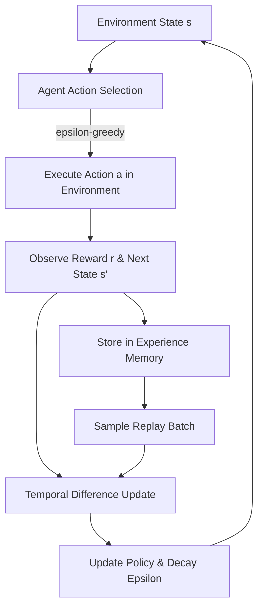

# Self-Learning AI Agent 🧠

A modular reinforcement learning (RL) framework implementing an adaptive, self-learning agent capable of discovering optimal policies through trial-and-error, experience replay, and temporal-difference learning.

---

## 🌟 Features

- **Self-Improving Policy:** Uses Q-Learning / Temporal Difference updates to learn optimal actions without prior domain knowledge.
- **Experience Replay Buffer:** Stores past interaction episodes to break correlation and stabilize learning convergence.
- **Exploration vs. Exploitation ($\epsilon$-decay):** Dynamically transitions from random exploration to high-confidence exploitation.
- **Configurable Environment:** Modular grid world with configurable state spaces, dynamic hazards, and goal topologies.
- **Model Checkpointing:** Serializes and loads learned action-value policies to/from JSON.

---

## 🏗️ Architecture

```
self-learning-ai-agent/
├── src/
│   ├── __init__.py
│   ├── agent.py          # Self-learning agent with Q-table & experience replay
│   ├── environment.py    # Environment state dynamics & reward signals
│   └── trainer.py        # Episode execution, metric tracking, & evaluation
├── checkpoints/          # Saved model weights/Q-tables
├── main.py               # Main training & evaluation entry point
├── requirements.txt      # Dependencies
└── README.md
```

---

## 🚀 Quick Start

### 1. Prerequisites
- Python 3.10+

### 2. Run Directly
The core reinforcement learning agent runs using Python's standard library with zero external dependencies required for quick testing:

```bash
python main.py
```

### 3. Optional Dependencies
For extended analytics and plotting:
```bash
pip install -r requirements.txt
```

---

## 📊 Training Workflow



---

## 📄 License
MIT License. Created by [@AdarshR8](https://github.com/AdarshR8).
